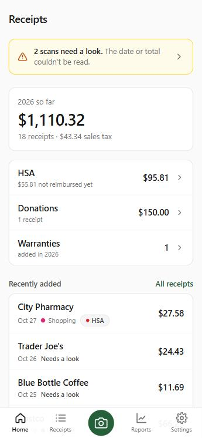
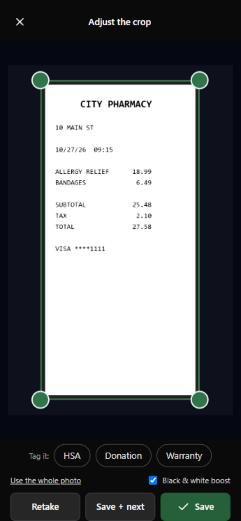
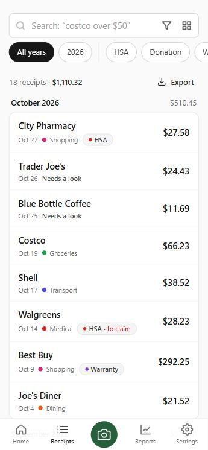
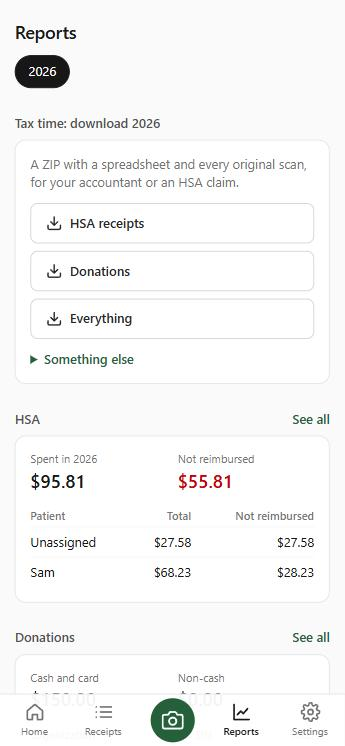

# Receipts

I wanted somewhere to keep receipts I might need later, mostly HSA claims,
donations and warranties, and be able to pull up a whole year of them at tax
time. So this is a small app that runs on a home server. You take a photo of a
receipt with your phone, it reads the date, store and total, and files the
picture in a folder by year and month:

```
receipts/2026/03/Groceries/2026-03-14_Walmart_22.70_<id>.jpg
receipts/2026/03/Groceries/2026-03-14_Walmart_22.70_<id>.json
```

The reading happens on your server. Nothing is sent anywhere else.

<p>
  
  
  
  
</p>

## What you can do with it

- Scan a receipt from your phone, or upload photos and PDFs. Tap HSA,
  Donation or Warranty while scanning to tag it.
- Most receipts file themselves. If the date or total can't be read, it shows
  up on the home screen so you can fill it in.
- Find receipts by year or tag, or search in plain words like "costco last
  month" or "hsa 2025".
- At tax time, download a year's HSA receipts or donations as a ZIP with a
  spreadsheet and every original.
- Share it with your household: everyone gets their own login.

## Setup

It runs on a Zima box under [zima-hub](https://github.com/VashuChogada/zima-hub),
which builds it from this repo and runs it in standard Docker images. Nothing
is built on your PC.

```bash
node <zima-hub>/cli/zima.mjs add app receipts VashuChogada/receipts --dir deploy/receipts
node <zima-hub>/cli/zima.mjs add app receipts-https VashuChogada/receipts --dir deploy/https
```

Then open `http://<your-server>:8490` on your phone or computer and create the
first account. The first start takes a few minutes while it installs what it
needs; watch it with `zima logs apps/receipts`. After that, every push to
`main` deploys by itself.

Settings (time zone, date order, currency) are the `vars` in
[deploy/receipts/zima.json](deploy/receipts/zima.json). Details are in
[docs/setup.md](docs/setup.md).

## Backups

Everything that matters is in `Data/apps/receipts/data/receipts/` on the box: the pictures and
a `.json` file next to each one. Copy that folder somewhere now and then. If
the database is ever lost, the app rebuilds it from those files.

## How it works

It's a Python (FastAPI) backend with SQLite, and a Preact web app you can add
to your phone's home screen. Receipts are read with PP-OCRv6, a small text
recognition model, with Tesseract as a fallback. Search uses a small
embedding model (bge-small) so "coffee" also finds a Starbucks receipt. Both
models load only when needed and unload after a few minutes, so the app idles
at about 60 MB of memory.

It runs on two standard Docker images (`python:3.12-slim` and
`caddy:2-alpine`). There's no custom image to build or download: the hub
assembles the code into a folder and the containers run it from there.
It's meant for your home network only, and turns away requests from the
internet.

More detail in [docs/architecture.md](docs/architecture.md). To run it on your
own computer while working on it, see
[docs/setup.md](docs/setup.md#running-it-locally).

## License

MIT
