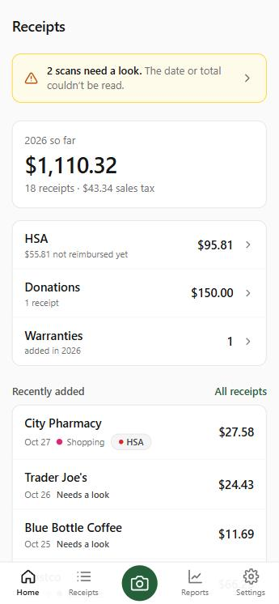
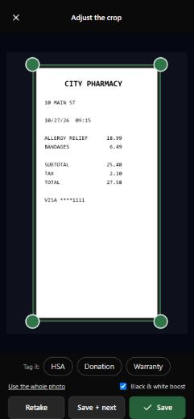
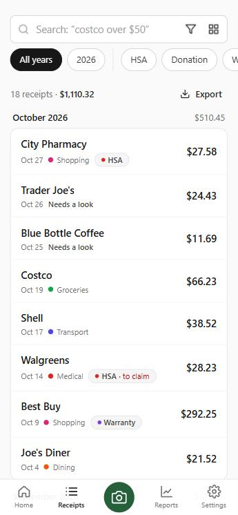
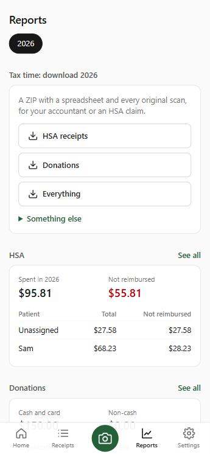

# Receipts

I wanted somewhere to keep receipts I might need later, mostly HSA claims,
donations and warranties, and be able to pull up a whole year of them at tax
time. So this is a small app that runs on a home server. You take a photo of a
receipt with your phone, it reads the date, store and total, and files the
picture in a folder by year and month:

```
receipts/2026/03/Groceries/2026-03-14_Walmart_22.70_<id>.jpg
receipts/2026/03/Groceries/2026-03-14_Walmart_22.70_<id>.json
```

The reading happens on your server. Nothing is sent anywhere else.

<p>
  
  
  
  
</p>

## What you can do with it

- Scan a receipt from your phone, or upload photos and PDFs. Tap HSA,
  Donation or Warranty while scanning to tag it.
- Most receipts file themselves. If the date or total can't be read, it shows
  up on the home screen so you can fill it in.
- Find receipts by year or tag, or search in plain words like "costco last
  month" or "hsa 2025".
- At tax time, download a year's HSA receipts or donations as a ZIP with a
  spreadsheet and every original.
- Share it with your household: everyone gets their own login.

## Setup

You need a Linux machine with Docker that stays on (a home server or NAS),
and Node 20 or newer on the computer you set it up from. They can be the same
machine.

1. Get the code and make your settings file:

   ```bash
   git clone https://github.com/VashuChogada/receipts.git
   cd receipts
   cp .env.example .env
   ```

2. Open `.env` and set `RECEIPTS_DIR` to a folder on the server, for example
   `/srv/receipts`. If you're setting it up from a different computer, also set
   `RECEIPTS_SHARE` to that same folder as your computer sees it (a network
   share).

3. Build the app and copy it to that folder:

   ```bash
   cd frontend && npm ci && cd ..
   node scripts/deploy.mjs
   ```

4. Start it on the server:

   ```bash
   docker compose --env-file .env -f deploy/compose.yaml up -d
   ```

   The first start takes a few minutes while it installs what it needs. You
   can watch with `docker logs -f receipts-app`.

5. Open `http://<your-server>:8490` on your phone or computer and create the
   first account.

To update later, pull the latest code and run `node scripts/deploy.mjs` again.
If it says the server code changed, run `docker restart receipts-app`.

Using ZimaOS or CasaOS? See [docs/setup.md](docs/setup.md#zimaos-or-casaos).

## Settings

These go in `.env`. Only `RECEIPTS_DIR` is required.

| Setting | Default | What it does |
|---|---|---|
| `RECEIPTS_DIR` | | Folder on the server where everything is kept |
| `RECEIPTS_SHARE` | same as `RECEIPTS_DIR` | Where `deploy.mjs` copies to, if you build on another computer |
| `TZ` | `UTC` | Your time zone |
| `DATE_ORDER` | `MDY` | `MDY` reads 03/04 as March 4, `DMY` as 3 April |
| `CURRENCY` | `USD` | Currency code for amounts |
| `HTTP_PORT` | `8490` | Port the app is on |
| `APP_PORT` | `8491` | Internal port, only change it if 8491 is taken |

To have every scan wait for you instead of filing itself, set `AUTO_FILE`
to `"off"` in `deploy/compose.yaml`.

## Backups

Everything that matters is in `RECEIPTS_DIR/data/receipts/`: the pictures and
a `.json` file next to each one. Copy that folder somewhere now and then. If
the database is ever lost, the app rebuilds it from those files.

## How it works

It's a Python (FastAPI) backend with SQLite, and a Preact web app you can add
to your phone's home screen. Receipts are read with PP-OCRv6, a small text
recognition model, with Tesseract as a fallback. Search uses a small
embedding model (bge-small) so "coffee" also finds a Starbucks receipt. Both
models load only when needed and unload after a few minutes, so the app idles
at about 60 MB of memory.

It runs on two standard Docker images (`python:3.12-slim` and
`caddy:2-alpine`). There's no custom image to build or download: the deploy
script copies the code into a folder and the containers run it from there.
It's meant for your home network only, and turns away requests from the
internet.

More detail in [docs/architecture.md](docs/architecture.md). To run it on your
own computer while working on it, see
[docs/setup.md](docs/setup.md#running-it-locally).

## License

MIT
